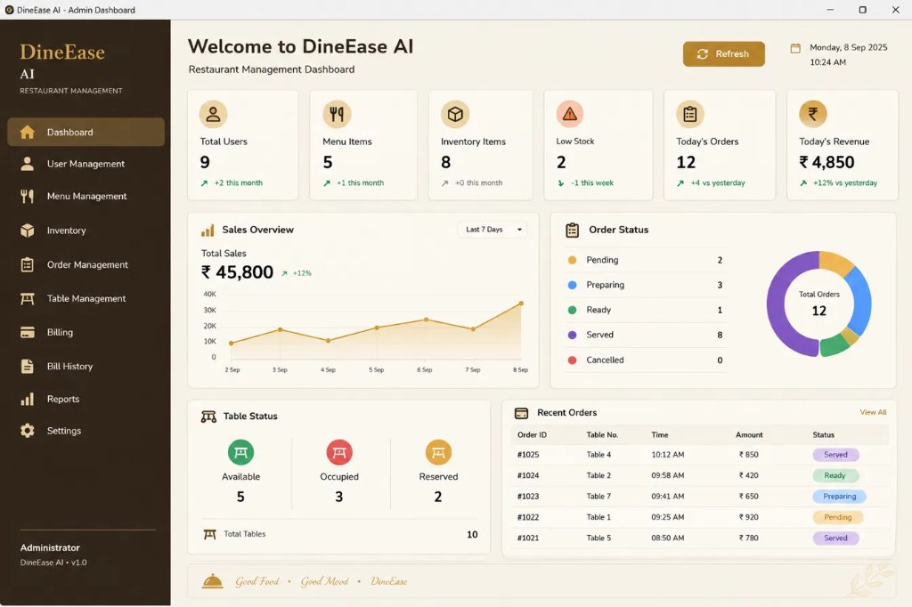
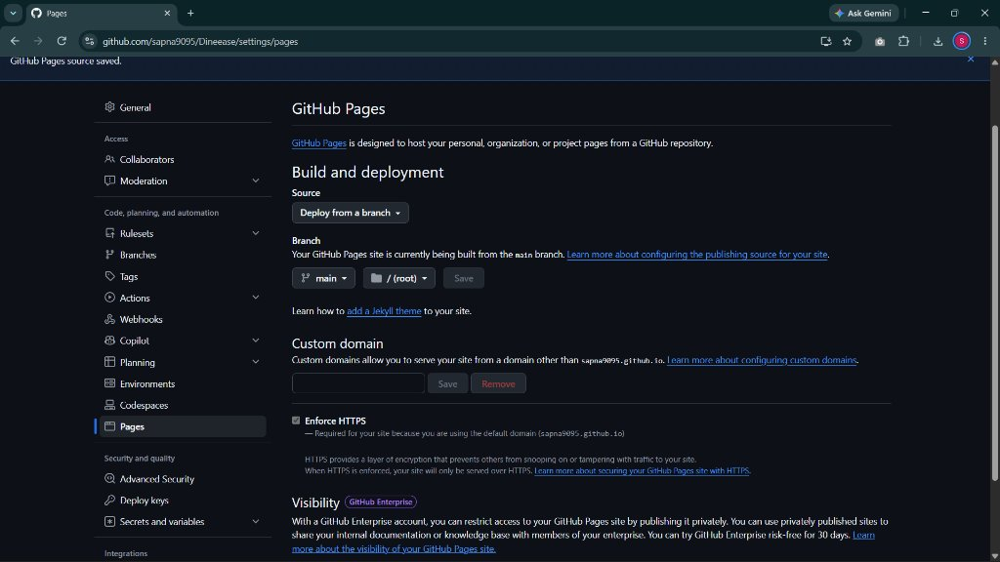

# DineEase AI – Restaurant Management System (Java Swing & MySQL)

[](https://www.oracle.com/java/)
[](https://www.formdev.com/flatlaf/)
[](https://www.mysql.com/)
[](LICENSE)
[](https://sapna9095.github.io/Dineease/)

> **Notice for Evaluators & Reviewers:**  
> **DineEase AI is a Native Desktop Application built with Java 17 Swing, FlatLaf, JDBC, and MySQL**.  
> The repository also includes a companion web interactive preview deployed on GitHub Pages for direct browser demonstration: [https://sapna9095.github.io/Dineease/](https://sapna9095.github.io/Dineease/).

---

## Table of Contents
1. [Project Overview](#project-overview)
2. [Project Objectives](#project-objectives)
3. [Technologies Used](#technologies-used)
4. [Key Features & Modules](#key-features--modules)
5. [Application Architecture](#application-architecture)
6. [Screenshots & Visuals](#screenshots--visuals)
7. [Database Setup & Configuration](#database-setup--configuration)
8. [Installation & Execution Guide](#installation--execution-guide)
9. [Default Demo Credentials](#default-demo-credentials)
10. [Dual Architecture: Desktop App vs. Web Preview](#dual-architecture-desktop-app-vs-web-preview)
11. [Future Scope](#future-scope)
12. [Developer & Project Information](#developer--project-information)

---

## Project Overview

**DineEase AI** is an enterprise-grade Restaurant Management and Point-of-Sale (POS) System developed as a rich desktop application using **Java 17 Swing, FlatLaf modern UI, JDBC, and MySQL**. It provides end-to-end automation for fine-dining restaurants, cafes, and cloud kitchens—unifying table booking, kitchen order tickets (KOT), real-time billing with dynamic tax calculation, inventory alerts, staff administration, sales analytics, and localized delivery dispatch with GPS route tracking.

---

## Project Objectives

- **Digitize Restaurant Operations**: Replace pen-and-paper order taking with instantaneous kitchen order generation and table status management.
- **Accurate Real-Time Accounting**: Provide zero-error billing with itemized discount structures, CGST/SGST tax computation, and automated PDF invoice generation.
- **Stock & Inventory Control**: Eliminate ingredient shortages through automatic reorder thresholds and low-stock visual badges.
- **High Performance & Luxury Aesthetics**: Deliver a responsive, modern desktop UI styled with an exquisite Cream & Gold palette (`#F7F1E5`, `#3B2414`, `#C8902E`) using custom `Graphics2D` hardware-accelerated rendering.
- **Data Integrity & Security**: Establish robust transactional persistence using MySQL with foreign key cascading and role-based access control (RBAC).

---

## Technologies Used

| Layer | Technology | Details |
|---|---|---|
| **Programming Language** | Java (JDK 17 LTS) | Core OOPs, Multithreading (`SwingWorker`), Streams, JDBC API |
| **Graphical User Interface** | Java Swing & Graphics2D | Custom vector charts, cards, layout managers (`CardLayout`, `GridBagLayout`) |
| **Look and Feel (Theme)** | FlatLaf 3.6 | Modern border radius, typography, anti-aliased shadows, and luxury dark/light palette |
| **Database** | MySQL 8.0+ | Relational schema, InnoDB transactional engine, foreign key cascades, triggers |
| **Connectivity** | MySQL Connector/J 9.4.0 | High-performance JDBC driver |
| **Build Management** | Apache Maven & Batch Scripts | Standard `pom.xml` configuration with one-click `build.bat` and `run.bat` |
| **Document Generation** | Apache PDFBox & iText 8 | Automated PDF receipt and tax invoice generation |
| **Icons & Typography** | Ikonli Swing & Playfair Display | Material Design vector icons and high-resolution typography |

---

## Key Features & Modules

### 1. Executive Analytics & Dashboard
- **Live Revenue Statistics**: Total Revenue, Active Orders, Table Utilization, and Inventory Shortages.
- **Custom Graphics2D Area Chart**: Smooth gradient spline chart displaying weekly sales performance with tooltip support.
- **Donut Order Status Breakdown**: Visual distribution of Pending, Preparing, Ready, and Served orders.
- **Real-Time Clocks**: Synchronized system date and live ticking time.

### 2. Dining Floor & Table Management
- Interactive floor grid displaying tables with live visual states: **Available (Green)**, **Occupied (Red)**, and **Reserved (Amber)**.
- One-click seat allocation and table status updates.

### 3. Kitchen Order Ticketing (KOT) & Order Lifecycle
- Multi-tier order progression: `PENDING` ➔ `PREPARING` ➔ `READY` ➔ `SERVED`.
- Kitchen ticket printing and table-linked takeaway tracking.

### 4. Interactive POS & Billing System
- Menu dish selection with real-time quantity multiplier.
- Subtotal calculation with split tax breakdown (**2.5% CGST + 2.5% SGST**).
- One-click invoice settlement, PDF receipt generation, and transaction logging.

### 5. Restaurant Menu Management
- Category-based dish segregation: *Starters, Main Course, Soups, Salads, Desserts, Beverages*.
- Live price editing, dish creation, and cascaded dish deletion preventing orphaned relational references.

### 6. Stock & Inventory Control
- Track essential ingredients, dairy, grains, and beverages with unit quantities.
- Visual warning badges for stock falling below reorder limits.

### 7. Online Delivery & Jaipur GPS Tracking
- Dedicated delivery dispatch for Jaipur zones: *Sitapura (Kitchen Hub), Mansarovar, Malviya Nagar, Vaishali Nagar, and Raja Park*.
- Interactive vector map rendering arterial delivery routes and live rider positions.

### 8. User Management & Security
- Role-Based Access Control (**ADMIN**, **MANAGER**, **STAFF**, **CHEF**).
- Password masking and secure session handling.

---

## Application Architecture

```
com.dineease
├── Main.java                             # Desktop entry point
├── controller/                           # Event handlers & MVC controllers
├── dao/                                  # JDBC Data Access Objects (SQL queries)
│   ├── BillDAO.java
│   ├── DashboardDAO.java
│   ├── DeliveryDAO.java
│   ├── InventoryDAO.java
│   ├── MenuDAO.java / MenuDAOImpl.java
│   ├── OrderDAO.java / OrderDAOImpl.java
│   └── UserDAO.java / UserDAOImpl.java
├── db/                                   # Database connection manager (db.properties)
├── model/                                # POJO entities (MenuItem, Order, Bill, User, etc.)
├── service/                              # Business logic & authentication services
├── ui/                                   # Swing UI frames, dialogs, & panels
│   ├── MainFrame.java                    # Master container with CardLayout
│   ├── SidebarPanel.java                 # Luxury themed sidebar navigation
│   ├── DashboardPanel.java               # Executive dashboard view
│   ├── components/                       # Custom Graphics2D charts, badges, stat cards
│   └── delivery/                         # Jaipur map GPS tracking panel
└── util/                                 # Font loaders, image scalers, UI constants
```

---

## Screenshots & Visuals

| Dashboard Overview | Live Deployment Preview |
|:---:|:---:|
|  |  |

---

## Database Setup & Configuration

### 1. Prerequisites
- MySQL Server 8.0 or higher running on `localhost:3306`.

### 2. Import Database Schema & Sample Data
A pre-configured, clean SQL export is located in `database/dineease_dump.sql`. You can import it using MySQL Workbench, phpMyAdmin, or the MySQL Command Line:

```bash
mysql -u root -p < database/dineease_dump.sql
```

Alternatively, launch MySQL CLI:
```sql
CREATE DATABASE IF NOT EXISTS dineease;
USE dineease;
SOURCE database/dineease_dump.sql;
```

### 3. Configure Database Credentials
Copy `db.properties.example` to `db.properties` in the project root folder:

```properties
# DineEase Database Configuration
db.host=localhost
db.port=3306
db.name=dineease
db.user=root
db.password=YOUR_MYSQL_PASSWORD
```

> **Security Note:** `db.properties` is registered in `.gitignore` and will never be committed to GitHub, protecting your private database password.

---

## Installation & Execution Guide

### Option A: One-Click Execution (Windows)
1. Double-click `build.bat` to compile all source code using JDK 17.
2. Double-click `run.bat` to launch the DineEase AI desktop application.

### Option B: Command Line (PowerShell / Command Prompt)

```powershell
# 1. Compile the project
javac -encoding UTF-8 -cp "lib\*" -d target\classes (Get-ChildItem -Path src\main\java -Filter "*.java" -Recurse | ForEach-Object { $_.FullName })

# 2. Copy resources
xcopy /E /I /Y "src\main\resources\*" "target\classes\"

# 3. Run the desktop application
java "-Dsun.java2d.uiScale=1" "-Dflatlaf.uiScale=1" -cp "target\classes;lib\*" com.dineease.Main
```

### Option C: Using Apache Maven
If Maven is installed on your system:
```bash
mvn clean package
java -jar target/DineEase-1.0.jar
```

---

## Default Demo Credentials

The database script provides safe pre-seeded credentials for testing:

| Role | Username | Password | Access Privileges |
|---|---|---|---|
| **Administrator** | `admin` | `admin123` | Full administrative access to all 11 modules |
| **Manager** | `manager` | `manager123` | Floor operations, billing, inventory, and reports |
| **Cashier** | `cashier` | `cashier123` | Table seating, POS order taking, and bill settlement |
| **Chef** | `chef` | `chef123` | Kitchen display system (KDS) and order status update |

---

## Dual Architecture: Desktop App vs. Web Preview

To facilitate both offline faculty evaluation and instant web demonstration, this repository is organized into a dual-access architecture:

1. **Core Submission (Java Swing Desktop Application)**:
   - Primary codebase inside `src/main/java/` and `lib/`.
   - Connected directly to local MySQL database with transaction atomicity.
   - Run via `run.bat` or Maven.

2. **Web Demonstration Preview (GitHub Pages)**:
   - Hosted live at: **[https://sapna9095.github.io/Dineease/](https://sapna9095.github.io/Dineease/)**
   - Implements interactive client-side state for faculty members and external reviewers wishing to evaluate the UI/UX, POS dish selector, and delivery dispatch without installing local JDK or MySQL.

---

## Future Scope

- **Cloud Synchronization**: Integration with cloud databases (AWS RDS / Google Cloud SQL) for multi-branch restaurant chains.
- **AI-Powered Demand Forecasting**: Predictive analytics utilizing machine learning to forecast weekend ingredient demand and reduce food wastage.
- **QR Code Table Ordering**: Integration with digital customer menus for self-service smartphone ordering directly to the kitchen display.
- **Thermal Printer Integration**: Native ESC/POS thermal printer support for high-speed kitchen order tickets.

---

## Developer & Project Information

- **Project Name**: DineEase AI – Restaurant Management System
- **Developer**: Sapna (Lead Developer & System Architect)
- **Course / Degree**: Bachelor of Technology (Computer Science & Engineering) / Master of Computer Applications
- **Repository**: [https://github.com/sapna9095/Dineease](https://github.com/sapna9095/Dineease)
- **Live Preview**: [https://sapna9095.github.io/Dineease/](https://sapna9095.github.io/Dineease/)

---
*Developed with precision for excellence in college submission and restaurant digital transformation.*
